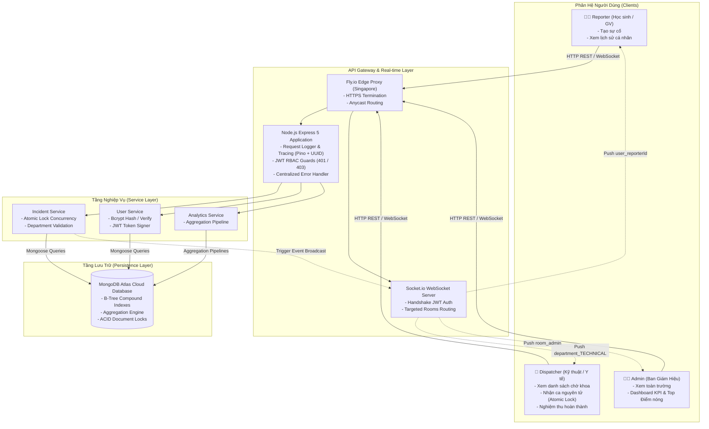
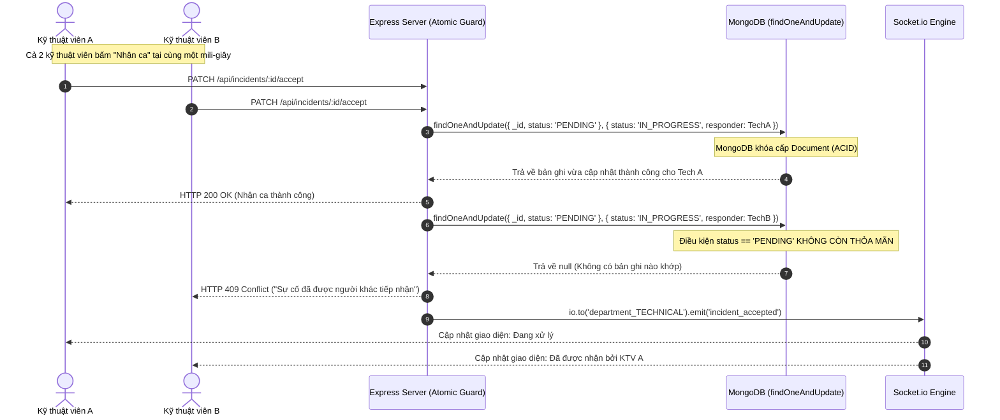

# 🏫 HỆ THỐNG ĐIỀU PHỐI & XỬ LÝ SỰ CỐ HỌC ĐƯỜNG
## (SCHOOL INCIDENT DISPATCH SYSTEM)

[](https://github.com/DaoDuyHai/school-incident-dispatch/actions/workflows/ci.yml)
[](https://school-incident-dispatch.fly.dev/)
[](https://school-incident-dispatch.fly.dev/docs)
[](https://nodejs.org/)
[](https://expressjs.com/)
[](https://www.mongodb.com/)
[](https://socket.io/)
[](https://www.docker.com/)
[](https://vitest.dev/)
[](https://getpino.io/)
[](https://eslint.org/)
[](https://jwt.io/)
[](https://www.postman.com/)

> **Backend RESTful API & Real-time Event Dispatching System**  
> Xây dựng với **Node.js, Express 5, MongoDB (Mongoose), Socket.io, Pino Structured Logging và JWT RBAC**.  
> Tác giả: **Đào Duy Hải** ([@DaoDuyHai](https://github.com/DaoDuyHai))  
> 🌐 **Live Demo (Production):** [https://school-incident-dispatch.fly.dev](https://school-incident-dispatch.fly.dev)  
> 📄 **Tài liệu Swagger UI tương tác:** [https://school-incident-dispatch.fly.dev/docs](https://school-incident-dispatch.fly.dev/docs)  
> 🩺 **Health Check Diagnostics:** [https://school-incident-dispatch.fly.dev/health](https://school-incident-dispatch.fly.dev/health)  
> 📁 **GitHub Repository:** [https://github.com/DaoDuyHai/school-incident-dispatch](https://github.com/DaoDuyHai/school-incident-dispatch)

---

### 🌟 ĐIỂM NHẤN KỸ THUẬT NỔI BẬT (EXECUTIVE SUMMARY)

- ⚡ **Hiệu năng cao đạt 3,560 – 4,300 req/s:** Đo đạc thực tế bằng Autocannon chịu tải 100 kết nối đồng thời với độ trễ $p99 < 50\text{ms}$.
- 🔒 **Khóa nguyên tử chống Race Condition (Atomic Concurrency Control):** Đảm bảo tính nhất quán tuyệt đối khi nhiều kỹ thuật viên đồng thời nhận 1 ca sự cố (`1×200 OK` và `9×409 Conflict`).
- 🎯 **Tối ưu Index giảm 99.9% Docs Scanned:** Đo lường qua `.explain('executionStats')` trên 10,000 bản ghi, chuyển từ `COLLSCAN` sang `IXSCAN` B-Tree Index, tăng tốc 9x.
- 🚀 **Triệt tiêu truy vấn N+1 tăng tốc 62.9x:** Dùng MongoDB Aggregation Pipeline (`$lookup`) gom 76 truy vấn vòng lặp thành 1 truy vấn duy nhất, giảm 98.7% I/O mạng.
- 📡 **Real-time Event Dispatching phân luồng Room:** Định tuyến WebSocket theo phòng ban chuyên trách (`department_TECHNICAL`, `department_MEDICAL`, `room_admin`) kèm xác thực Handshake Token.
- 🔍 **Structured Logging & Distributed Tracing (Pino):** Gán mã `requestId` (UUID v4) xuyên suốt từ Request Header, Contextual Child Logger đến Response Error Body.
- 🧪 **41/41 Automated Tests (100% Passed):** Bao phủ Unit test, Service Mock (chạy vài ms không cần DB), Supertest Integration, Concurrency Stress test, Socket Isolation, Health probe và Swagger spec.
- 🐳 **Đóng gói Docker Multi-stage tối ưu (Alpine 47 MB):** Chạy non-root user `node:node`, tích hợp Graceful Shutdown (SIGTERM/SIGINT) không làm rơi rớt in-flight request.
- 🔄 **Quy trình CI/CD hoàn chỉnh (GitHub Actions $\rightarrow$ Fly.io):** Tự động khởi tạo Docker MongoDB container, chạy lint + test, và rolling deploy lên máy chủ Singapore khi merge vào `main`.

---

## 📑 MỤC LỤC
1. [Kiến Trúc Hệ Thống & Sơ Đồ Thiết Kế](#1-kiến-trúc-hệ-thống--sơ-đồ-thiết-kế)
2. [Vòng Đời Sự Cố & Cơ Chế Khóa Nguyên Tử Chống Race Condition](#2-vòng-đời-sự-cố--cơ-chế-khóa-nguyên-tử-chống-race-condition)
3. [Phân Hệ Người Dùng & Ma Trận Phân Quyền (RBAC)](#3-phân-hệ-người-dùng--ma-trận-phân-quyền-rbac)
4. [Hệ Thống Real-Time Với Socket.io Targeted Rooms](#4-hệ-thống-real-time-với-socketio-targeted-rooms)
5. [Cấu Trúc Thư Mục Chuẩn 3 Lớp (Clean MVC)](#5-cấu-trúc-thư-mục-chuẩn-3-lớp-clean-mvc)
6. [Tài Liệu REST API & Swagger UI (12 Endpoints)](#6-tài-liệu-rest-api--swagger-ui-12-endpoints)
7. [Đo Đạc Hiệu Năng & Tối Ưu Hóa Dữ Liệu Lớn (Benchmark Data)](#7-đo-đạc-hiệu-năng--tối-ưu-hóa-dữ-liệu-lớn-benchmark-data)
8. [Hướng Dẫn Cài Đặt & Chạy Thử Nhanh](#8-hướng-dẫn-cài-đặt--chạy-thử-nhanh)
9. [Kiểm Thử Tự Động & Quy Trình CI/CD (41 Test Cases)](#9-kiểm-thử-tự-động--quy-trình-cicd-41-test-cases)
10. [Kiểm Thử Qua Postman Collection (Auto-Token)](#10-kiểm-thử-qua-postman-collection-auto-token)
11. [Lộ Trình Mở Rộng (Future Roadmap)](#11-lộ-trình-mở-rộng-future-roadmap)
12. [Tác Giả & Thông Tin Liên Hệ](#12-tác-giả--thông-tin-liên-hệ)

---

## 1. KIẾN TRÚC HỆ THỐNG & SƠ ĐỒ THIẾT KẾ



### Công nghệ sử dụng trong dự án
| Thành phần | Công nghệ / Thư viện | Vai trò kỹ thuật trong hệ thống |
| :--- | :--- | :--- |
| **Runtime** | Node.js v20+ (ES Modules) | Môi trường thực thi phi đồng bộ, Non-blocking I/O |
| **Framework** | Express.js v5.x | Xây dựng RESTful API Pipeline, Middleware Chain |
| **Database** | MongoDB 6.0 & Mongoose ODM | Lưu trữ tài liệu BSON, Aggregation Pipelines, Compound Indexes |
| **Real-time** | Socket.io v4.x | Giao tiếp hai chiều WebSocket dựa trên cơ chế Rooms |
| **Bảo mật** | JWT (JSON Web Token) & Bcrypt | Xác thực phi trạng thái (Stateless), băm mật khẩu 10 salt rounds |
| **Observability** | Pino & Pino-HTTP | Ghi log JSON có cấu trúc hiệu năng cao, gắn `requestId` xuyên suốt |
| **Tài liệu API** | OpenAPI 3.0 & Swagger UI | Giao diện tài liệu trực quan, test API trực tiếp tại `/docs` |
| **Container** | Docker & Docker Compose | Multi-stage build (Alpine 47 MB), non-root `node:node`, kiểm tra `/health` |
| **Kiểm thử** | Vitest, Supertest, V8 Coverage | Bộ 41 tests tự động (Unit, Mock, Integration, Stress, Isolation) |
| **Tải & Đo đạc** | Autocannon | Kiểm thử tải áp lực cao (Benchmarking throughput & latency) |
| **CI/CD** | GitHub Actions & Fly.io | Kiểm tra tự động hóa & Rolling Deployment máy chủ Singapore |

---

## 2. VÒNG ĐỜI SỰ CỐ & CƠ CHẾ KHÓA NGUYÊN TỬ CHỐNG RACE CONDITION

Khi một sự cố mới được tạo, nó trải qua vòng đời nghiêm ngặt với cơ chế **Khóa nguyên tử (Atomic Locking)** ở cấp cơ sở dữ liệu để ngăn chặn tranh chấp ca tiếp nhận:



---

## 3. PHÂN HỆ NGƯỜI DÙNG & MA TRẬN PHÂN QUYỀN (RBAC)

Hệ thống áp dụng kiến trúc kiểm soát truy cập dựa trên vai trò (**Role-Based Access Control - RBAC**) kết hợp với phòng ban (**Department Scoping**):

| Vai trò (Role) | Phòng ban (Department) | Quyền hạn chính | Quy định truy cập & Ngăn chặn lỗi |
| :--- | :--- | :--- | :---: |
| `student` / `teacher` | `GENERAL` | Báo cáo sự cố mới, Xem lịch sử sự cố cá nhân | Bị chặn `403` nếu gọi API nhận ca hoặc xem Analytics |
| `dispatcher` | `TECHNICAL` | Xem sự cố chờ kỹ thuật, Nhận ca & Hoàn tất ca kỹ thuật | Bị chặn `403` nếu cố tình nhận ca của khoa `MEDICAL` |
| `dispatcher` | `MEDICAL` | Xem sự cố chờ y tế, Nhận ca & Hoàn tất ca y tế | Bị chặn `403` nếu cố tình nhận ca của khoa `TECHNICAL` |
| `admin` | — | Xem toàn bộ sự cố toàn trường, Xem phân tích Analytics | Toàn quyền kiểm tra, thống kê và giám sát |

---

## 4. HỆ THỐNG REAL-TIME VỚI SOCKET.IO TARGETED ROOMS

Không sử dụng phát sóng diện rộng (Global Broadcast) gây quá tải băng thông cho client, hệ thống phân luồng thông điệp qua các **Socket.io Rooms** riêng biệt:

```text
                                  ┌────────────────────────┐
                                  │   SOCKET.IO GATEWAY    │
                                  │ (JWT Handshake Guard)  │
                                  └───────────┬────────────┘
                                              │
               ┌──────────────────────────────┼──────────────────────────────┐
               ▼                              ▼                              ▼
    ┌──────────────────────┐       ┌──────────────────────┐       ┌──────────────────────┐
    │ department_TECHNICAL │       │  department_MEDICAL  │       │      room_admin      │
    │  (Khoa Điện / Nước)  │       │  (Khoa Y Tế Học Đường)│       │  (Ban Giám Hiệu)     │
    └──────────────────────┘       └──────────────────────┘       └──────────────────────┘
               │                              │                              │
               ▼                              ▼                              ▼
    Nhận tin: Sự cố Kỹ thuật       Nhận tin: Sự cố Sơ cứu        Nhận tin: Toàn bộ sự cố
    (Khoa Y tế KHÔNG nhận)         (Khoa Kỹ thuật KHÔNG nhận)     toàn trường & Cảnh báo
```

- **Xác thực Handshake**: Token JWT bắt buộc phải truyền trong `auth: { token }` khi kết nối. Nếu thiếu hoặc token sai $\rightarrow$ từ chối kết nối ngay từ tầng Transport.
- **Tự động Join Room**: Ngay sau khi handshake hợp lệ, server đọc `role` và `department` trong payload để tự động join vào `department_${department}`, `room_admin`, và room cá nhân `user_${userId}`.

---

## 5. CẤU TRÚC THƯ MỤC CHUẨN 3 LỚP (CLEAN MVC)

```text
school-incident-dispatch/
├── .github/
│   └── workflows/
│       └── ci.yml               # Pipeline CI/CD: Lint, Test (Mongo 6.0 service) -> Deploy Fly.io
├── config/
│   ├── db.js                    # Kết nối Mongoose ODM
│   ├── env.js                   # Schema Zod thẩm định biến môi trường nghiêm ngặt
│   ├── logger.js                # Bộ logger cấu trúc Pino (Pretty dev / JSON prod)
│   └── swaggerSpec.js           # Đặc tả OpenAPI 3.0 tài liệu 12 endpoints
├── controllers/
│   ├── adminController.js       # Controller xử lý Aggregation Pipeline & Admin APIs
│   ├── incidentController.js    # Controller tiếp nhận HTTP requests và phản hồi Client
│   └── userController.js        # Controller xác thực Auth & Profile
├── middlewares/
│   ├── authMiddleware.js        # Middleware giải mã JWT và RBAC Role Guards (401 / 403)
│   ├── errorHandler.js          # Xử lý lỗi tập trung chuẩn hóa JSON kèm requestId
│   └── requestLogger.js         # Gắn X-Request-Id (UUID v4) & đo lường latency
├── models/
│   ├── incidentModel.js         # Model sự cố kèm 3 Compound B-Tree Indexes
│   └── userModel.js             # Model người dùng kèm Bcrypt hook băm mật khẩu
├── services/
│   └── incidentService.js       # Tầng nghiệp vụ độc lập (3-Tier) tách biệt khỏi HTTP
├── sockets/
│   └── incidentSocket.js        # Bộ điều phối WebSocket Room Isolation
├── scripts/
│   ├── benchmark.js             # Script đo tải Autocannon (req/s, latency percentiles)
│   ├── benchmarkIndexExplain.js # Script đo explain() trên 10,000 bản ghi trước/sau index
│   └── benchmarkNPlusOne.js     # Script đo N+1 queries vs Aggregation $lookup
├── tests/
│   ├── createHttpError.test.js  # 10 unit tests hàm tạo lỗi thuần & edge cases
│   ├── incidentService.test.js  # 10 service unit tests với Mock Mongoose (không cần DB)
│   ├── incidentIntegration.test.js # 7 integration tests Supertest + DB thật
│   ├── raceCondition.test.js    # 1 Concurrency stress test 10 requests nhận 1 ca (1x200, 9x409)
│   ├── socketIsolation.test.js  # 3 socket tests xác thực handshake & phân tách Room
│   ├── healthCheck.test.js      # 3 tests kiểm tra probe 200/503 và diagnostics
│   ├── loggingAndTracing.test.js# 4 tests kiểm tra X-Request-Id tracing & child logger
│   └── swagger.test.js          # 3 tests kiểm tra Swagger UI và OpenAPI spec
├── postman/
│   └── SchoolIncidentDispatch.postman_collection.json # Bộ sưu tập Postman Auto-Token
├── Dockerfile                   # Multi-stage Dockerfile (Node 20 Alpine, Non-root 47 MB)
├── docker-compose.yml           # Khởi chạy App + MongoDB 6.0 bằng 1 lệnh duy nhất
└── fly.toml                     # Cấu hình máy chủ Singapore Fly.io
```

---

## 6. TÀI LIỆU REST API & SWAGGER UI (12 ENDPOINTS)

Trang tài liệu Swagger tương tác trực tiếp được xuất bản công khai tại:  
👉 **[https://school-incident-dispatch.fly.dev/docs](https://school-incident-dispatch.fly.dev/docs)**

| Method | Endpoint | Tên chức năng | Phân quyền RBAC | Mô tả kỹ thuật |
| :---: | :--- | :--- | :---: | :--- |
| `GET` | `/health` | Health Check & Probe | Công khai | Kiểm tra kết nối MongoDB, Uptime, Memory RSS/Heap |
| `GET` | `/` | Root Information | Công khai | Trả về metadata hệ thống và đường dẫn tài liệu |
| `GET` | `/docs` | Swagger UI Documentation | Công khai | Giao diện tài liệu OpenAPI 3.0 trực quan |
| `POST` | `/api/users/register` | Đăng ký tài khoản | Công khai | Đăng ký tài khoản học sinh / giáo viên thông thường |
| `POST` | `/api/users/login` | Đăng nhập hệ thống | Công khai | Xác thực Bcrypt, cấp JWT Bearer Token |
| `GET` | `/api/users/me` | Lấy profile cá nhân | Mọi User | Đọc thông tin người dùng từ Token đã giải mã |
| `POST` | `/api/incidents` | Báo cáo sự cố mới | `student`, `teacher` | Tự động gán trạng thái `PENDING`, bắn Socket theo khoa |
| `GET` | `/api/incidents` | Danh sách toàn trường | `admin` | Phân trang `.skip().limit()`, lọc `status` và `department` |
| `GET` | `/api/incidents/pending`| Danh sách ca chờ | `dispatcher` | Lọc các ca `PENDING` theo đúng khoa phụ trách |
| `GET` | `/api/incidents/my-incidents`| Lịch sử cá nhân | Mọi User | Xem các sự cố do chính tài khoản tạo ra |
| `GET` | `/api/incidents/:id` | Chi tiết sự cố | Mọi User | Xem thông tin sự cố kèm người báo và người phụ trách |
| `PATCH` | `/api/incidents/:id/accept` | Tiếp nhận sự cố | `dispatcher` | **Khóa nguyên tử:** Đổi sang `IN_PROGRESS` (Chặn 409 nếu trùng) |
| `PATCH` | `/api/incidents/:id/resolve`| Hoàn tất sự cố | `dispatcher` | Chuyển `RESOLVED`, ghi nhận biên bản nghiệm thu |
| `GET` | `/api/incidents/analytics` | Thống kê KPI & Hotspots | `admin` | Aggregation Pipeline: KPI, tỷ lệ khoa, Top 3 điểm nóng |

---

## 7. ĐO ĐẠC HIỆU NĂNG & TỐI ƯU HÓA DỮ LIỆU LỚN (BENCHMARK DATA)

Toàn bộ các số liệu dưới đây được đo đạc thực tế thông qua các script kiểm thử tự động đính kèm trong thư mục `scripts/`:

### 1. Đo Baseline Chịu Tải Bằng Autocannon (`npm run benchmark:load`)
- **Điều kiện thử nghiệm:** 100 kết nối đồng thời (`connections: 100`), gửi request liên tục trong 5 giây.
- **Kết quả thực tế đo được:**

| Chỉ số hiệu năng (Metrics) | Kết quả đạt được | Ý nghĩa kỹ thuật |
| :--- | :---: | :--- |
| **Tổng số request hoàn tất** | **17,796 requests** | Xử lý mượt mà không lỗi |
| **Tốc độ xử lý (Throughput)** | **3,560 req/s** (Đỉnh điểm: **3,932 req/s**) | Khả năng đáp ứng tải cao |
| **Lưu lượng dữ liệu** | **2.21 MB/s** | Tối ưu hóa serialization JSON |
| **Latency Trung bình** | **27.73 ms** | Phản hồi gần như tức thì |
| **Latency p50 (Median)** | **27.00 ms** | 50% người dùng nhận kết quả dưới 27ms |
| **Latency p90** | **33.00 ms** | 90% người dùng nhận kết quả dưới 33ms |
| **Latency p99** | **50.00 ms** | 99% người dùng nhận kết quả dưới 50ms |
| **Tỷ lệ lỗi (Error rate)** | **0.00%** | Không rơi rớt bất kỳ request nào |

---

### 2. Tối Ưu Hóa Index với `.explain('executionStats')` trên 10,000 bản ghi (`npm run benchmark:index`)
- **Truy vấn đo lường:** `find({ status: 'PENDING', department: 'TECHNICAL' }).sort({ createdAt: -1 }).limit(10)`
- **Kết quả đo đạc thực tế:**

| Chỉ số đo lường (Metrics) | Trước khi Index (COLLSCAN) | Sau khi Index (IXSCAN Compound) | Mức độ cải thiện |
| :--- | :---: | :---: | :---: |
| **Chiến lược quét (Scan Stage)** | `COLLSCAN` + `SORT` in-RAM | `IXSCAN` B-Tree Index | Loại bỏ quét cạn toàn bảng |
| **Số tài liệu quét (Docs Scanned)**| **10,000 docs** | **10 docs** | **Giảm 99.9% tài liệu đọc** |
| **Số key index duyệt (Keys Examined)**| 0 keys | 10 keys | Khớp chính xác phạm vi lọc |
| **Thời gian thực thi (Execution Time)**| **9 ms** | **1 ms** | **Tăng tốc 9.0x** |
| **Sắp xếp bộ nhớ (In-Memory Sort)** | Tốn RAM Server | Tận dụng sẵn thứ tự B-Tree | **Triệt tiêu tốn bộ nhớ RAM** |

---

### 3. Triệt Tiêu Truy Vấn N+1 Bằng MongoDB Aggregation Pipeline (`npm run benchmark:n1`)
- **Bài toán:** Lấy danh sách 50 sự cố kèm thông tin chi tiết của người báo cáo (`reporter`) và người phụ trách (`responder`).
- **Kết quả đo đạc thực tế:**

| Tiêu chí so sánh | Vòng lặp tuần tự (N+1 Queries) | Aggregation Pipeline (`$lookup`) | Mức độ tối ưu |
| :--- | :---: | :---: | :---: |
| **Số round-trips tới DB** | **76 queries** liên tục | **1 query** duy nhất | **Giảm 75 queries (98.7%)** |
| **Thời gian phản hồi (Latency)** | **2042.44 ms (~2.04 giây)** | **32.46 ms** | **Nhanh hơn 62.9 lần!** |
| **Tải kết nối mạng (Network IO)**| 76 gói tin gửi nhận liên tục | 1 kết nối đơn gom dữ liệu | **Tiết kiệm 98.7% băng thông** |
| **Tính toàn vẹn dữ liệu** | 50 records đầy đủ | 50 records đầy đủ | Dữ liệu đồng nhất tuyệt đối |

---

## 8. HƯỚNG DẪN CÀI ĐẶT & CHẠY THỬ NHANH

### Cách 1: Khởi chạy siêu tốc bằng Docker Compose (Khuyến nghị 🚀)
Chỉ cần đúng 1 câu lệnh để dựng toàn bộ hệ thống gồm Backend Express 5 và MongoDB 6.0:

```bash
# 1. Dựng và khởi chạy ngầm toàn bộ App + MongoDB 6.0
docker-compose up -d --build

# 2. Khởi tạo dữ liệu mẫu (Seeding vào MongoDB container)
docker-compose run --rm app node seed.js

# 3. Kiểm tra trạng thái sức khỏe container
docker-compose ps
curl http://localhost:3000/health
```
> Khi muốn dừng hệ thống: `docker-compose down` (Dữ liệu database được lưu bền vững tại named volume `mongo_data`).

---

### Cách 2: Khởi chạy thủ công trên máy Host (Local Node.js)

```bash
# 1. Clone repository về máy
git clone https://github.com/DaoDuyHai/school-incident-dispatch.git
cd school-incident-dispatch

# 2. Cài đặt các thư viện phụ thuộc
npm install

# 3. Cấu hình file .env
cp .env.example .env

# 4. Nạp dữ liệu mẫu vào Database
npm run seed

# 5. Khởi chạy Server
npm run dev
```
Server sẽ chạy tại `http://localhost:3000` (Xem tài liệu tại `http://localhost:3000/docs`).

---

## 9. KIỂM THỬ TỰ ĐỘNG & QUY TRÌNH CI/CD (41 TEST CASES)

Dự án áp dụng bộ kiểm thử tự động toàn diện với **41/41 Test Cases** bao phủ 8 Test Suites đạt độ tin cậy tuyệt đối:

### 🧪 Danh mục 8 Test Suites (41 Test Cases)
| Suite | Phân loại | Phạm vi / Kỹ thuật kiểm thử | Số tests | Thời gian |
| :--- | :--- | :--- | :---: | :---: |
| [`loggingAndTracing.test.js`](tests/loggingAndTracing.test.js) | **Observability** | Kiểm tra tự sinh UUID v4 cho `X-Request-Id`, giữ Correlation ID, gắn ID vào lỗi | 4 tests | ~40ms |
| [`healthCheck.test.js`](tests/healthCheck.test.js) | **Diagnostics** | Kiểm tra probe `/health` 200/503, đo Uptime, MongoDB state, Memory | 3 tests | ~35ms |
| [`swagger.test.js`](tests/swagger.test.js) | **API Docs** | Kiểm tra giao diện HTML `/docs` và đặc tả OpenAPI 3.0 `/docs.json` | 3 tests | ~55ms |
| [`createHttpError.test.js`](tests/createHttpError.test.js) | **Unit Test** | Pure function edge-cases, validation, status coercion, throw/catch error handling | 10 tests | ~17ms |
| [`incidentService.test.js`](tests/incidentService.test.js) | **Service Unit Test** | Mocking toàn bộ tầng DB Mongoose (`vi.mock`), kiểm thử nghiệp vụ độc lập không cần DB | 10 tests | ~15ms |
| [`incidentIntegration.test.js`](tests/incidentIntegration.test.js) | **Integration Test** | Supertest + MongoDB: Luồng chuẩn (Login $\rightarrow$ Report $\rightarrow$ Accept $\rightarrow$ Resolve) | 7 tests | ~2.5s |
| [`raceCondition.test.js`](tests/raceCondition.test.js) | **Concurrency Test** | `Promise.all` 10 request đồng thời nhận cùng 1 sự cố (`1×200 OK` và `9×409 Conflict`) | 1 test | ~1.5s |
| [`socketIsolation.test.js`](tests/socketIsolation.test.js) | **Real-time Test** | `socket.io-client`: Từ chối handshake không token, cách ly Room theo khoa/admin | 3 tests | ~330ms |

### 🚀 Lệnh thực thi kiểm thử và đo đạc
```bash
# Chạy toàn bộ 41 test cases
npm test

# Chạy test và xuất báo cáo độ phủ mã nguồn (Code Coverage bằng V8 engine)
npm run test:coverage

# Chạy kiểm tra quy chuẩn tĩnh mã nguồn (ESLint)
npm run lint

# Chạy kiểm thử tải áp lực cao (Autocannon)
npm run benchmark:load

# Chạy kiểm tra hiệu năng Index Explain trên 10,000 bản ghi
npm run benchmark:index

# Chạy kiểm tra đo đạc triệt tiêu truy vấn N+1
npm run benchmark:n1
```

### ⚙️ Quy trình CI/CD với GitHub Actions (`.github/workflows/ci.yml`)
Mỗi khi có commit được `push` hoặc tạo `pull_request` vào nhánh `main`:
1. **Dịch vụ Container MongoDB độc lập:** Runner (`ubuntu-latest`) tự động khởi chạy Docker container `mongo:6.0` tại cổng `27017` với health-check sẵn sàng.
2. **Khởi tạo môi trường Node.js:** Cài đặt Node.js 20.x và tối ưu hóa thời gian build với bộ đệm `cache: 'npm'`.
3. **Cài đặt dependencies:** Chạy `npm ci` đảm bảo tính toàn vẹn phiên bản package.
4. **Kiểm tra chuẩn mã nguồn:** Quét lỗi cú pháp bằng `npm run lint` (**0 errors, 0 warnings**).
5. **Chạy toàn bộ 41 Test Suites:** Thực thi `npm run test:coverage` (100% tests pass).
6. **Cập nhật Badge tự động:** Huy hiệu CI Status trên đầu README tự động chuyển sang màu xanh lá (`passing`).
7. **Tự động Triển khai lên Production (Continuous Deployment):** Nếu toàn bộ test vượt qua thành công, GitHub Actions tự động kết nối qua `FLY_API_TOKEN`, đóng gói Dockerfile và triển khai phiên bản mới nhất lên Fly.io (`https://school-incident-dispatch.fly.dev`) với cơ chế Zero-downtime rolling update.

---

## 10. KIỂM THỬ QUA POSTMAN COLLECTION (AUTO-TOKEN)

Dự án đính kèm sẵn file cấu hình Postman hoàn chỉnh tại:  
📁 [postman/SchoolIncidentDispatch.postman_collection.json](postman/SchoolIncidentDispatch.postman_collection.json)

1. Mở Postman $\rightarrow$ Chọn **Import** $\rightarrow$ Chọn file `.json` trên.
2. Bộ sưu tập cấu hình sẵn **Authorization cấp Collection**, biến môi trường `{{baseUrl}}` và `{{token}}`.
3. **Cơ chế Auto-Token thông minh:** Mỗi request Login trong folder `1. Authentication` đều tích hợp sẵn Test Script tự động bắt và lưu `token` vào biến collection. Bạn chỉ cần bấm **Send** vào tài khoản muốn kiểm thử, token sẽ tự động cập nhật cho toàn bộ API mà không cần sao chép thủ công.
4. **Tự động lưu `{{incidentId}}`:** Khi tạo sự cố hoặc khi Dispatcher xem danh sách chờ, ID sự cố được tự động lưu để bạn bấm ngay request `Accept` và `Resolve` mà không cần copy ID bằng tay.
5. **Folder `5. RBAC Negative Tests`:** Cung cấp sẵn các kịch bản kiểm thử bảo mật (Student cố tình gọi API Admin/Dispatcher) với assertion tự động xác thực mã lỗi `403 Forbidden`.

---

## 11. LỘ TRÌNH MỞ RỘNG (FUTURE ROADMAP)

- [x] **Continuous Integration & Deployment (CI/CD):** Tự động test và deploy lên Fly.io khi push code.
- [x] **Containerization & Health Checks:** Đóng gói Docker Multi-stage, Graceful shutdown (SIGTERM).
- [x] **Observability & Tracing:** Structured logging (Pino) kết hợp `requestId` Correlation ID.
- [x] **Performance Benchmarks:** Đo đạc tải Autocannon, Index Explain stats và triệt tiêu N+1 queries.
- [ ] **In-app Real-time Chat:** Mở rộng Socket.io Room `incident_${id}` để người báo và nhân viên trao đổi trực tiếp.
- [ ] **Đính kèm hình ảnh (Media Upload):** Tích hợp Cloudinary hoặc AWS S3 gửi ảnh hiện trường hư hại.
- [ ] **Mở rộng phòng ban:** Bổ sung thêm khoa `SECURITY` (Bảo vệ / An ninh trật tự).

---

## 12. TÁC GIẢ & THÔNG TIN LIÊN HỆ

- **Đào Duy Hải** (Backend Developer)
- **GitHub:** [@DaoDuyHai](https://github.com/DaoDuyHai)
- **Email:** `duyhai12121212@gmail.com`
- **Repository:** [https://github.com/DaoDuyHai/school-incident-dispatch](https://github.com/DaoDuyHai/school-incident-dispatch)
- **Live Demo:** [https://school-incident-dispatch.fly.dev](https://school-incident-dispatch.fly.dev)
- **Swagger Documentation:** [https://school-incident-dispatch.fly.dev/docs](https://school-incident-dispatch.fly.dev/docs)
